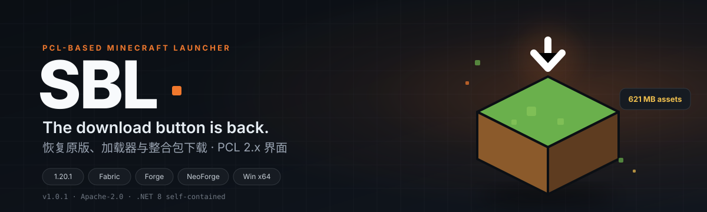

<div align="center">
  
  <br><br>

  [](https://github.com/CalitonBL/SBL/releases/latest)
  [](LICENSE)
  [](https://github.com/CalitonBL/SBL/releases/latest)
  [](docs/BUILD.md)
  [](https://github.com/CalitonBL/SBL/commits/main)
  [](https://github.com/CalitonBL/SBL/issues)

  [**下载 SBL 1.0.1**](https://github.com/CalitonBL/SBL/releases/latest) ·
  [构建文档](docs/BUILD.md) ·
  [CurseForge 说明](docs/CURSEFORGE.md) ·
  [问题反馈](https://github.com/CalitonBL/SBL/issues)

  <sub>SBL is a free, non-commercial Windows Minecraft launcher forked from PCL2-CE (Apache-2.0).<br>
  It restores the in-launcher download feature removed in PCL 2.99. Downloads use official Mojang / CurseForge / Modrinth CDN URLs; SBL does not re-host mod files.</sub>
</div>

---

## 为什么是 SBL

PCL 2.99 的更新日志里写着：

> 删除：为遵守相关法律法规，PCL 暂时不再提供 MC 下载功能，非常抱歉 qwq……

下载没了之后，启动器里会出现两个很具体的问题：

- **原版装不了**：下载页只剩版本列表，没有可用的安装入口；
- **整合包导入报红**：整合包需要对应版本，而启动器已经不能把它下载回来。

SBL 保留了 PCL 的界面、安装器和启动逻辑，只把下载能力恢复，并清掉 PCL CE 的社区版提示、调查、自动更新与遥测。

## 真实界面


<details>
<summary>启动页截图</summary>


</details>

## 能做什么

| 能力 | 说明 |
| --- | --- |
| 原版下载 | 正式版 / 预览版 / 远古版 / 愚人节版；Mojang 官方源 + BMCLAPI 镜像 |
| 加载器 | Forge、NeoForge、Fabric、Quilt、OptiFine、LiteLoader、Cleanroom |
| 整合包 | Modrinth `.mrpack`、CurseForge 整合包、手动导入 |
| 启动 | Java 自动扫描、版本隔离、崩溃分析、离线账号 |
| 界面 | PCL 2.x 原版布局：启动 / 下载 / 设置 / 工具 |

## 快速开始

1. 从 [Releases](https://github.com/CalitonBL/SBL/releases/latest) 下载 `SBL-1.0.1-win-x64.zip` 并解压。
2. 打开 `SBL.exe` → **下载** → 选一个版本 → **开始下载**。
3. 回 **启动** → **实例选择** → 选中刚下载的实例 → **启动游戏**。

> **Java**：SBL 会自动扫描本机 Java。1.20.1 需要 Java 17，1.20.5+ 需要 Java 21。
> 没有 Java 时，启动会提示自动下载；也可以在 **设置 → 启动选项 → 游戏 Java** 中手动导入。

## 支持的版本与加载器

| 类型 | 支持情况 |
| --- | --- |
| 原版 | 1.0 – 最新正式版 / 预览版；正式、快照、远古、愚人节分类 |
| Forge / NeoForge | 通过官方安装器安装，自动写入版本 JSON |
| Fabric / Quilt | 通过 Fabric / Quilt Meta 安装 |
| OptiFine / LiteLoader / Cleanroom | 内置安装页 |
| 整合包 | Modrinth `.mrpack`、CurseForge zip、手动导入 |
| 账号 | 离线登录；微软正版登录（需自备 Azure Client ID） |

## 可选：微软登录与 CurseForge

SBL 从 `SBL.exe` 同目录的 `sbl-secrets.json` 读取两个可选密钥（模板见
[`sbl-secrets.example.json`](sbl-secrets.example.json)）：

```json
{
  "MS_CLIENT_ID": "",
  "CURSEFORGE_API_KEY": ""
}
```

- **微软登录**：`MS_CLIENT_ID` 是**启动器的应用身份**，注册一次后可随包分发。
  朋友点“正版验证”后，会在微软官方页面登录**他们自己的账号**。
- **CurseForge**：需要审核通过的 **Organization key**；Per-game key 无法搜索 Minecraft 公开模组库。

详细步骤（Azure 应用注册、Organization key、自检脚本）见
[`docs/BUILD.md`](docs/BUILD.md)。

> 密钥只放在本机，`sbl-secrets.json` 已被 `.gitignore` 忽略；不要提交、截图或发给别人。

## 从源码构建

需要 **.NET 10 SDK**（`PCL.Core` 使用 C# 14）：

```powershell
dotnet publish "Plain Craft Launcher 2/Plain Craft Launcher 2.vbproj" `
  -c Release -p:Platform=x64 -r win-x64 --self-contained true -o dist
```

生成 `dist/SBL.exe`（单文件、自包含 .NET 8）。完整说明见 [`docs/BUILD.md`](docs/BUILD.md)。

## 已知限制

- 微软登录需要 Azure Client ID，并通过 Microsoft 的 **Minecraft App Registration 审核**
  （<https://aka.ms/mce-reviewappid>）；未通过时 `login_with_xbox` 会返回 403 `Invalid app registration`。
  不填/未过审时只能离线登录，或使用内置的 **LittleSkin** 第三方验证。
- CurseForge 需要审核通过的 Organization key；不填时仅 Modrinth 与官方源可用。
- 联机大厅已移除，不包含 Natayark 相关服务。
- 单文件约 168 MB；游戏目录路径含中文时首次会提示“非 ASCII 路径”，选继续/不再提示即可。

## 许可与致谢

- 本项目以 **Apache-2.0** 发布，见 [`LICENSE`](LICENSE)。
- 上游：[PCL2-CE](https://github.com/PCL-Community/PCL2-CE)（Apache-2.0）；原始 PCL 版权归 **龙腾猫跃** 所有。
- SBL 是个人修改版，与 Mojang、Microsoft、龙腾猫跃、PCL-Community 均无隶属关系。
- Minecraft 是 Mojang 的商标；请遵守 Minecraft EULA 与当地法律法规。
- 本项目**不包含盗版本体、不破解正版验证**；离线模式仅供本地单人/局域网使用。

更多署名与第三方组件见 [`NOTICE.md`](NOTICE.md)。
