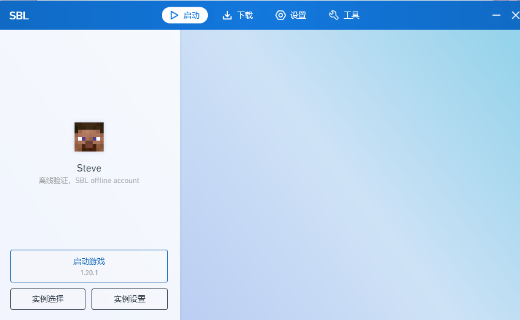
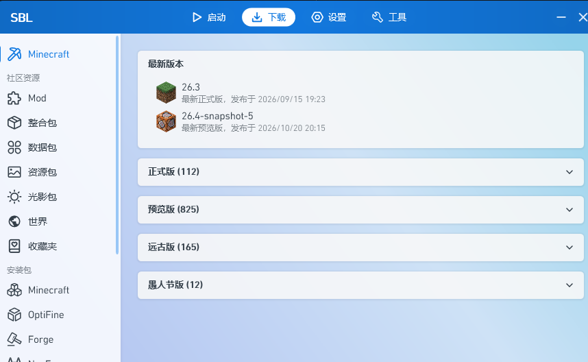
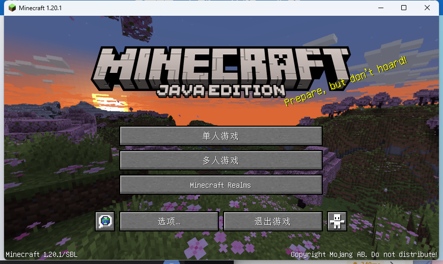

# SBL

**A PCL-based Minecraft launcher with the in-launcher download feature restored.**

SBL 是一个非商业、开源的 Windows Minecraft 启动器，基于 [PCL2-CE](https://github.com/PCL-Community/PCL2-CE)（Apache-2.0）。
它保留了 PCL 的界面与安装逻辑，并恢复了 PCL 2.99 中被删除的 Minecraft 下载功能：
原版游戏、Forge / Fabric / NeoForge / Quilt / OptiFine，以及整合包导入。

> **English**: SBL is a free, non-commercial Windows Minecraft launcher forked from
> [PCL2-CE](https://github.com/PCL-Community/PCL2-CE) (Apache-2.0). It restores the in-launcher
> Minecraft download feature removed in PCL 2.99 while keeping the familiar PCL interface.
> All downloads use official Mojang / CurseForge / Modrinth CDN URLs; SBL does not re-host or
> mirror mod files. API usage is user-initiated, rate-limited, and metadata is cached only briefly.







## 功能

- **原版下载**：正式版 / 预览版 / 远古版 / 愚人节版，支持 Mojang 官方源与 BMCLAPI 镜像。
- **安装器**：Forge、NeoForge、Fabric、Quilt、OptiFine、LiteLoader、Cleanroom。
- **整合包**：Modrinth `.mrpack`、CurseForge 整合包、手动导入。
- **启动**：Java 自动扫描、版本隔离、崩溃分析、离线账号。
- **界面**：PCL 2.x 原版界面，单人 / 多人 / 版本管理 / 设置齐全。

## 下载

从 [Releases](https://github.com/CalitonBL/SBL/releases/latest) 下载 `SBL-1.0.1-win-x64.zip`。

- 单文件 `SBL.exe`，自包含 .NET 8，**不需要安装运行时**。
- 解压后双击即可；首次启动按提示选择版本 / 创建离线账号。

## 使用

1. 双击 `SBL.exe`。
2. **下载** → 选版本 → **开始下载**。
3. **启动** → **实例选择** → 选中实例 → **启动游戏**。
4. 离线账号：主页账号卡片 → 新建档案 → 离线登录。

Java：SBL 会自动扫描本机 Java；1.20.1 需要 Java 17，1.20.5+ 需要 Java 21。
没有 Java 时可在 **设置 → 启动选项 → 游戏 Java** 中导入，或使用 PCL 的自动下载。

## 可选：微软登录与 CurseForge

SBL 支持从 exe 旁的 `sbl-secrets.json` 读取两个可选密钥（模板见
[`sbl-secrets.example.json`](sbl-secrets.example.json)）：

```json
{
  "MS_CLIENT_ID": "",
  "CURSEFORGE_API_KEY": ""
}
```

- **微软登录**：`MS_CLIENT_ID` 是**启动器自己的** Azure 应用 Client ID，不是账号密码。
  注册一次后可以随包分发；朋友点“正版验证”后会在微软官方页面登录**他们自己的账号**。
  注册步骤见 [`docs/BUILD.md`](docs/BUILD.md#微软登录可选)。
- **CurseForge**：需要 **Organization key** 且 API 申请已通过审核；
  Per-game key 无法搜索 Minecraft 公开模组库。使用说明见
  [`docs/BUILD.md`](docs/BUILD.md#curseforge-可选)。

> 密钥只放在本机，`sbl-secrets.json` 已在 `.gitignore` 中；不要提交、截图或发给别人。

## 构建

需要 **.NET 10 SDK**（`PCL.Core` 使用 C# 14）：

```powershell
dotnet publish "Plain Craft Launcher 2/Plain Craft Launcher 2.vbproj" `
  -c Release -p:Platform=x64 -r win-x64 --self-contained true -o dist
```

生成 `dist/SBL.exe`。完整说明见 [`docs/BUILD.md`](docs/BUILD.md)。

## 与 PCL2-CE 的差异

- 程序名、窗口标题、图标、关于页改为 **SBL**。
- 删除“社区版提示 / 社区版说明 / 软硬件调查 / 联机大厅入口”等 CE 专属内容。
- 禁用 PCL CE 自动更新（避免 SBL 被替换回 PCL CE）与遥测。
- 删除离线账号每次启动的“考虑一下正版？”弹窗。
- 新扫描到的 Java 默认启用。
- 数据目录隔离为 `%APPDATA%\SBL`、`%APPDATA%\.sbl`、`%TEMP%\SBL`。
- 增加 `sbl-secrets.json` 运行时密钥支持（微软登录 / CurseForge）。

## 已知限制

- 微软登录需要你自己注册一次 Azure 应用（免费）；不填则只能离线登录。
- CurseForge 需要审核通过的 Organization key；不填时仅 Modrinth 与官方源可用。
- 联机大厅已移除，不包含 Natayark 相关服务。
- 单文件约 168 MB；游戏目录路径含中文时首次会提示“非 ASCII 路径”，选继续/不再提示即可。

## 许可与声明

- 本项目以 **Apache-2.0** 发布，见 [`LICENSE`](LICENSE)。
- 上游：PCL2-CE（Apache-2.0）；原始 PCL 版权归 **龙腾猫跃** 所有。
- SBL 是个人修改版，与 Mojang、Microsoft、龙腾猫跃、PCL-Community 均无隶属关系。
- Minecraft 是 Mojang 的商标；请遵守 Minecraft EULA 与当地法律法规。
- 本项目**不包含盗版本体、不破解正版验证**；离线模式仅供本地单人/局域网使用。
- 上游 PCL 仓库的使用指引对衍生作品的命名/分发有额外要求，公开分发前请自行核对
  [`docs/UPSTREAM-PCL-USAGE.md`](docs/UPSTREAM-PCL-USAGE.md)。

更多署名与第三方组件见 [`NOTICE.md`](NOTICE.md)。
